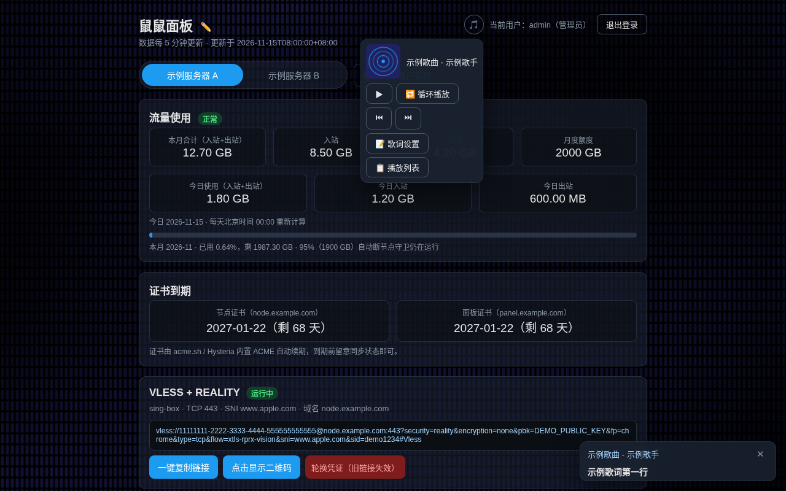
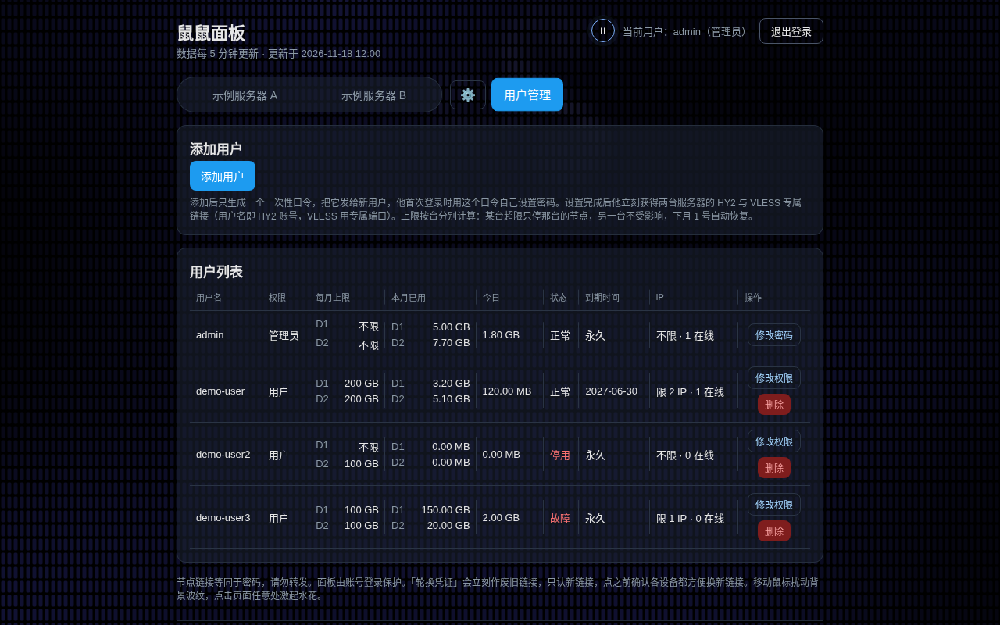
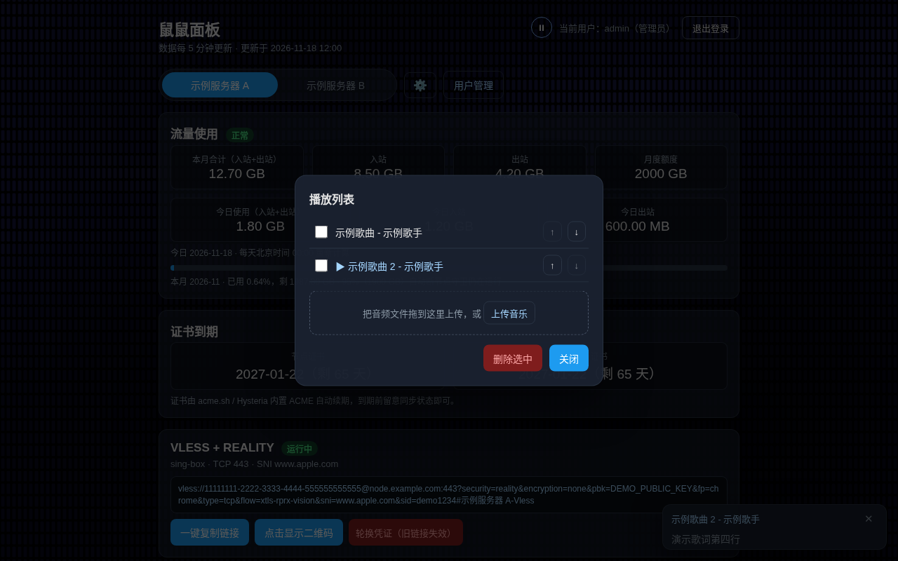
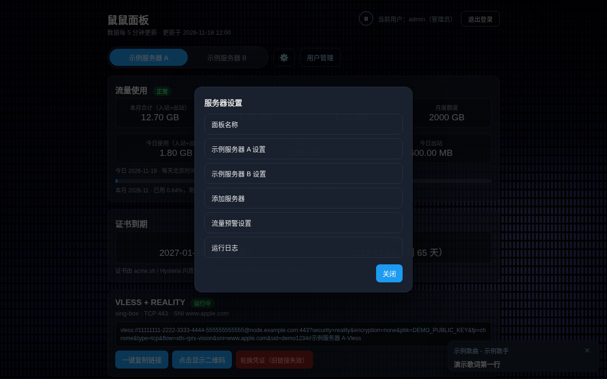

# Mouse Panel 🐹 V1.1.3

  

*本项目使用 [Meta Muse](https://muse.ai) 制作。*

一个自托管的节点面板：一台 VPS 上同时跑 **sing-box（VLESS + Reality）** 与 **Hysteria 2**，再加一个网页面板管理它们——看流量、复制链接、扫码导入、轮换凭证、给别人开账号、放背景音乐，都在一个页面里完成。

面板本身也是自适应的：**单机**只装一台时只显示本机；**多机**时可以在面板里再加远程服务器（装好 agent 即可），切换标签就能看另一台的流量与节点。



> 截图里的域名、IP、链接、曲名全是演示数据（example.com / 203.0.113.10 / 演示曲目），不是真实节点。

## 功能

- **节点链接与二维码**：VLESS（Reality）与 Hysteria 2 各一张卡片，一键复制链接（蓝色），点按钮弹出二维码（蓝色）；轮换凭证是较小的红色按钮。手机扫码导入客户端。
- **流量与证书**：本月合计 / 今日使用（vnstat 统计，每天北京时间 00:00 切换），节点证书与面板证书的到期时间，sing-box / Hysteria 2 的运行状态；数据每 5 分钟刷新。
- **凭证轮换**：点「轮换凭证」，旧链接立刻失效，只生成新链接。轮换 HY2 时会同步给所有普通用户生成新密码并暂时停用他们（管理员在用户管理里点「启用」即可恢复），停用期间他们的 VLESS 节点也会同步撤掉；轮换 VLESS 只换管理员自己的 UUID，不动普通用户的 VLESS。
- **多用户**：HY2 与 VLESS 都是多用户：每个普通用户在每台服务器上都有自己的 HY2 账号与一条 VLESS（专属 UUID 与端口，两台服务器同一个）。用户页面顶部可以切换服务器，看各台的流量与链接；管理员给每个用户按台分别设每月上限，某台超限只停那台的节点。用量按服务器统计（D1 合计、D2 合计），Hysteria 2 与 VLESS 合并计算。
- **流量预警**：每月流量达到提醒阈值时发 Telegram 提醒，达到自动停用阈值时停用本机节点（远程服务器只提醒、需手动停）。阈值与 Bot 配置在服务器 ⚙️ 设置里改；每月只提醒 / 停用一次，下月自动重置，恢复需手动启动节点。
- **多用户**：管理员添加用户（可设每月流量上限，留空 = 不限），系统生成一个一次性口令发给对方；对方首次登录时自己设置密码，之后只能看到自己的两台 HY2 专属链接和自己的流量。超上限自动停用，下月 1 号自动恢复。普通用户登录后可以在顶栏点「修改密码」自己改密码（同时也是 HY2 新密码）；管理员可以在给用户改密码的弹窗里关掉这个权限，关掉后用户点开弹窗会看到「功能被管理员禁用」。
- **到期时间与 IP 限制**：给用户设到期日期（到期后两台同时停用，不自动恢复）与同时在线 IP 上限（HY2 建连时检查，0 = 不限）。用户列表里能看到每个用户当前在线的 IP。
- **端口跳跃**：HY2 可以改成监听一个 UDP 区间（如 `20000-40000`），客户端在区间内跳着连；默认关闭，开之前要先在云厂商防火墙放行该区间的 UDP。
- **音乐播放列表**：顶栏的 🎵 按钮可以暂停 / 播放、切换循环模式（循环播放 / 随机播放 / 单曲循环）、上一首 / 下一首、打开播放列表；播放列表里可以点歌、上传音乐（支持拖拽）、上下移动排序、多选删除（仅管理员）。音乐文件只存在你自己的服务器上，不进这个仓库。
- **服务器管理**：面板名默认「鼠鼠面板」，可以改；服务器标签按 `servers.json` 动态渲染，一台只显示本机名字，多台显示切换标签，本机始终排在最前面，远程按添加顺序往后排；每台名字后有个 ⚙️ 设置按钮，可以改名、删除远程服务器、添加新 VPS（添加时先测 SSH 连通性，不通也会保存但带警告）。
- **公开流量页**：`/traffic` 免登录，只显示本月流量，适合分享给别人看用量。
- **背景特效**：深蓝细条海浪（Micro Slats），移动鼠标扰动波纹、点击激起水花；空格键可以暂停 / 播放音乐。
- **首次打开设管理员**：安装时不预置任何账号，第一次打开面板会让你创建管理员账号，建完直接进入面板。

## 快速安装

在一台全新的 **Debian 11 / 12** 或 **Ubuntu 22.04 / 24.04** 服务器上，以 **root** 运行：

```bash
curl -fsSL https://raw.githubusercontent.com/drinksomewarmwater/Mouse-Panel/main/install.sh | bash
```

或下载后执行：

```bash
curl -fsSL -o install.sh https://raw.githubusercontent.com/drinksomewarmwater/Mouse-Panel/main/install.sh
bash install.sh
```

脚本会装好 sing-box、Hysteria 2、acme.sh（签证书）、Caddy（面板，端口安装时定）、面板前端与后端、5 分钟定时任务（流量采集 + 用户流量统计）。脚本可重复运行：已装好的组件会跳过，已有的配置与证书会复用，不会把凭证换掉；重跑时端口默认沿用上次的选择。

## 安装时填什么

| 提示 | 说明 |
| --- | --- |
| ① 节点域名 | VLESS 与 HY2 共用的域名，如 `node.example.com`，**须已解析到本机公网 IP**，否则证书签发失败。 |
| ② 面板域名 | 默认 `panel.<节点域名去掉首段>`，如节点域是 `node.example.com` 则默认 `panel.example.com`；也可以直接输入完整域名。 |
| ③ ACME 邮箱 | 可选，用于证书到期通知，可空。 |
| ④ 每月流量额度 | GB，默认 2000；填 0 表示不限。 |
| ⑤ 面板端口 | 默认 8443。优先级：① 自填最优先（任意 1–65535 的端口，被占用则提示重填）；② 回车（不填）且 8443 空闲 → 用 8443；③ 回车且 8443 被别的服务占用 → 自动挑一个 10000–19999 的空闲端口（会明确告诉你改成了哪个）；④ 重跑安装时 8443 正由 Caddy 占用 → 沿用 8443。面板地址就是 `https://<面板域名>:<面板端口>`。 |
| ⑥ 节点端口 | VLESS（TCP）与 HY2（UDP）共用一个端口号。优先级：① 自填最优先（任意 1–65535 的端口，被占用则提示重填）；② 回车（不填）且 443 空闲 → 用 443；③ 回车且 443 被别的服务占用 → 自动挑一个 10000–19999 的空闲端口（会明确告诉你改成了哪个）；④ 重跑安装时 443 正由 sing-box / Hysteria 占用 → 沿用 443。节点端口不能与面板端口相同。VLESS Reality 在非 443 端口上与正常 HTTPS 流量相似度略低，但功能完全一致，个人使用无影响。 |

安装前脚本会先检查：域名是否解析到本机、80 端口是否空闲（签证书用）。任何一步失败都会直接退出并告诉你原因。

### 免交互安装

设环境变量可跳过对应提问，全部设好即全程不交互（借鉴 hysteria2-installer 的做法）：

```bash
MP_NODE_DOMAIN=node.example.com MP_PANEL_DOMAIN=panel.example.com \
  MP_ACME_EMAIL=me@example.com MP_QUOTA_GB=2000 \
  MP_PANEL_PORT=8443 MP_NODE_PORT=443 \
  bash <(curl -fsSL https://raw.githubusercontent.com/drinksomewarmwater/Mouse-Panel/main/install.sh)
```

| 环境变量 | 对应 | 说明 |
| --- | --- | --- |
| `MP_NODE_DOMAIN` | ① 节点域名 | 必填，须已解析到本机 |
| `MP_PANEL_DOMAIN` | ② 面板域名 | 不设则默认 `panel.<节点域名去掉首段>` |
| `MP_ACME_EMAIL` | ③ ACME 邮箱 | 可空 |
| `MP_QUOTA_GB` | ④ 每月流量额度 | GB，`0` 表示不限；不设默认 2000 |
| `MP_PANEL_PORT` | ⑤ 面板端口 | 不设默认 8443（被占自动改随机） |
| `MP_NODE_PORT` | ⑥ 节点端口 | 不设默认 443（被占自动改随机），不能与面板端口相同 |

环境变量不合法（域名格式不对、端口越界或被占用）时安装直接退出，不回落到交互提问。

装完会打印：面板地址、节点域名、VLESS / HY2 端口、VLESS 链接、初始 HY2 管理员密码（**只显示这一次**）。注意：首次在面板里设置管理员后，HY2 密码会重新生成，请以面板里显示的链接为准；VLESS 链接不受影响。

## 防火墙

**面板与安装脚本不自动配置防火墙**。云厂商的防火墙在控制台那边，不在服务器上，安装脚本够不着；把云账号密钥交给面板也不安全。所以装完之后，须自己在云厂商控制台（或主机防火墙）放行以下端口。

面板端口和节点端口按同一个优先级定，**自填最优先**：

1. **自填**：安装时自己填了端口，就用填的那个。
2. **默认**：安装时直接回车（不填），且默认端口空闲，就用默认的——面板 8443，节点 443。
3. **随机**：安装时直接回车，但默认端口被别的服务占了，脚本自动在 **10000–19999** 里挑一个空闲端口（会明确告诉你改成了哪个）。

要放行的端口：

| 端口 | 用途 |
| --- | --- |
| 80（TCP） | 安装时签证书用（acme.sh），签完可关 |
| 面板端口（TCP） | 按上面优先级定的实际值，默认 8443 |
| 节点端口（TCP + UDP） | 按上面优先级定的实际值，默认 443；VLESS（TCP）与 Hysteria 2（UDP）共用一个端口号 |
| 20000–40000（TCP） | 每个用户的 VLESS 专属端口（加用户时在该范围内随机分配） |

**省事的办法：把 443、8443 和 10000–40000 一次性放开**，之后加减用户、重装都不用再动防火墙了——默认端口、自动挑的端口、用户 VLESS 端口都在里面。如果安装时自填了范围外的端口，记得把填的那个也单独放行。

各家默认防火墙不一样，新实例建好后先确认缺了哪些：

| 云厂商 | 新实例默认放行的端口 | 备注 |
| --- | --- | --- |
| Lightsail | TCP 22、80 | 443 默认不开，须手动加 |
| Oracle 云（OCI） | TCP 22 | 80、443 默认不开；而且是双层防火墙，云上的安全列表和主机里的 iptables 都得开，只开一边还是不通 |
| Google 云（GCP） | 内网互通、TCP 22、3389，ICMP | 默认网络自带这几条；80、443 默认不开，建机器时勾选“允许 HTTP/HTTPS 流量”才会开，或事后在 VPC 防火墙里加 |
| 普通 VPS（DigitalOcean、Vultr、Linode 等） | 全部放行 | 默认没有云防火墙、主机也没开防火墙，端口全通，直到你自己装 ufw 之类才开始拦 |

## 首次打开

打开安装完打印的面板地址（`https://<面板域名>:<面板端口>`，端口是安装时定的，默认随机），页面会让你创建管理员账号：用户名默认 `admin`，密码至少 6 位。密码可以自己填，也可以点“🎲 生成强密码”生成一个 16 位强密码（大小写字母 + 数字 + 符号），生成后会填进两个密码框并显示出来，记下来再提交。建完直接进入面板。之后管理员的登录密码可以在「用户管理」顶部的「修改密码」里改（只改面板登录密码，不动 HY2 密码）。

## 面板用法

### 链接与二维码

每张节点卡片里有链接文本框、一键复制链接、点击显示二维码。链接等同于密码，不要转发。按钮颜色：一键复制链接与点击显示二维码是蓝色，轮换凭证是红色（危险操作，按钮也更小）。移动鼠标可以扰动背景波纹，点击页面任意处激起水花。

### 流量与证书

流量卡片显示本月合计、入站、出站、今日使用与剩余额度；证书卡片显示节点证书与面板证书的到期日期（acme.sh 自动续期）。「数据每 5 分钟更新 · 更新于……」是最后一次采集的时间。

### 轮换凭证

每张节点卡片的按钮行里，一键复制链接与点击显示二维码后面，有一个较小的红色「轮换凭证（旧链接失效）」按钮。点开会弹出确认框（只有点「取消」或「确定」才能关），点确定后页面自动刷新，新链接就显示在卡片里。**轮换前请确认各设备都方便换新链接**：

- 轮换 VLESS：只换这一台的 VLESS UUID，HY2 不受影响；普通用户的 VLESS UUID 与端口不受影响。
- 轮换 HY2：管理员与所有普通用户的 HY2 密码都会重新生成，普通用户会被暂时停用（状态显示「轮换后停用」），管理员在用户管理里点「启用」即可恢复，启用后显示的就是新链接。用户被停用期间，他的 VLESS 节点也会同步撤掉，重新启用时再加回来。

### 用户管理

点顶栏的「用户管理」。添加用户时只填用户名（2–32 位，支持中文、字母、数字、下划线和横线）与每台服务器的每月上限（每台一个输入框，留空 = 不限）；还可以顺手设一个到期日期与同时在线 IP 上限（都可空）。添加后会弹出一个窗口，里面有用户名、一次性口令、登录网址与一键注册链接：**先点「复制注册信息」，再点「确认已复制」**，把复制的内容发给对方。对方点开注册链接，填好密码就自动登录。



用户列表里能看到每个用户的密码（即 HY2 密码，与面板登录密码相同）、VLESS UUID 与端口、上限（按台显示）、本月已用（按台显示）、今日用量与状态；点「修改权限」打开一个弹窗，里面是流量设置、修改密码（弹窗里可以勾选是否允许该用户自行修改密码）、到期时间、IP限制、停用 / 启用（已停用的显示启用用户），点某一项再打开对应的设置弹窗；删除按钮直接留在用户行上。上限按台分别计算：某台用量超过该台上限，只停掉该用户在那台的节点（HY2 与 VLESS 都撤掉），另一台不受影响；超上限停用的用户下月 1 号按台自动恢复；轮换后停用的用户需要管理员手动启用。

**到期时间**：给用户设一个到期日期（留空 = 永久），用滚轮选择器挑年月日（与运行日志下载的自定义时间同一组件，只有年月日 3 列）。到期后账号在两台服务器上同时停用（HY2 与 VLESS 都撤掉），不会自动恢复；管理员重新启用时，到期时间会被清掉（改为永久），避免启用后 5 分钟内又被停掉。

**同时在线 IP 限制**：限制一个账号同时能从几个不同 IP 上线（0 = 不限）。HY2 通过 HTTP 鉴权在建连时检查：新设备上线时，若该账号在最近 30 分钟内已从其他 IP 鉴权过、且数量已达到上限，新连接会被拒绝。VLESS 不走这条鉴权，所以 VLESS 的 IP 不计入。注意这是按“最近鉴权”统计的：一个设备连上后几小时不重连，它的 IP 会从计数里掉出去（Hysteria 的统计接口只给会话数、不给 IP，做不到实时会话计数）。列表里会显示每个用户当前在线的 IP（最近 10 分钟内鉴权过的）。

普通用户登录后能看到自己的 HY2 与 VLESS 专属链接（每台服务器各一张卡片）和自己的流量，也进不了用户管理。用户页面顶部有服务器切换标签，点哪台就显示哪台的流量与链接。顶栏「退出登录」旁边有个「修改密码」按钮，点开可以自己改密码（要先输当前密码；新密码同时也是 HY2 新密码）。**用量按服务器统计（D1 合计、D2 合计），Hysteria 2 与 VLESS 合并计算。**

### 音乐播放列表

顶栏与手机端底部各有一个 🎵 按钮。桌面端把鼠标悬停在按钮上、手机端点一下，会展开控制条：暂停 / 播放、循环模式（循环播放 → 随机播放 → 单曲循环）、上一首、下一首、歌词设置、播放列表。控制条顶部会显示当前歌曲的封面（没有封面时显示 🎵 占位）。点「播放列表」弹出窗口，可以点歌、上传音乐（支持把音频文件拖进窗口，单个文件上限 100MB）、上下移动排序、多选删除（仅管理员）。**空格键也可以暂停 / 播放**（在输入框、按钮、链接获得焦点时不会触发，以免干扰输入）。

封面与歌词优先读音乐文件里内嵌的（封面、带时间戳的歌词）；文件里没有时，歌词去 [lrclib](https://lrclib.net) 检索（带时间戳的 LRC 歌词，可跟随播放滚动高亮），封面去 iTunes 检索（只认歌名、歌手都对得上的结果，宁可没有也不拿错的）。悬浮歌词默认只显示当前一行（桌面右下角、手机在底部音乐条上方，不挡内容）；鼠标悬停时展开为 5 行（当前行居中、上下各两行），点一下固定展开、再点恢复一行；按住拖动可移动到任意位置。点控制条里的「歌词设置」可以开关悬浮歌词、切换识别源（在线识别 / 仅本地）、重新识别当前歌曲。识别结果只缓存在浏览器本地，不会写进仓库或服务器。



音乐文件放在服务器的 `music/` 目录下，播放列表存在 `/var/lib/mouse-panel/playlist.json`。**音乐文件有版权，不会放进这个仓库**，请用自己的音频文件。

### 服务器设置

点服务器标签旁边的 ⚙️，弹出服务器设置窗口：可以改面板名称、改每台 VPS 的名字与每月流量额度、删除远程服务器、添加新 VPS。添加时填名字、主机 / IP、SSH 端口与每月额度（可空），面板会先测 SSH 连通性，不通也会保存但带警告；之后要在目标服务器上安装 agent（见下节）并授权面板的 SSH 公钥。

**端口跳跃**：每台服务器行里可以给 HY2 设一个跳跃区间（例如 `20000-40000`，留空 = 关闭）。开启后 HY2 不再只监听单个端口，而是监听整个 UDP 区间，客户端在区间内跳着连，链接里会多一个 `mport` 参数。**开之前必须先在云厂商防火墙放行该区间的 UDP**（只放行 TCP 不够），否则 HY2 连不上。默认是关闭的，新装也不开；VLESS 的端口不受影响，仍用节点端口。



### 流量预警

每月流量快用完时提醒你、用完时自动停节点，避免超额。配置在服务器 ⚙️ 设置窗口里的「流量预警」一段（仅管理员）：

1. **建机器人**：在 Telegram 里找 [@BotFather](https://t.me/BotFather)，发 `/newbot` 按提示建一个机器人，拿到 Bot Token（形如 `123456:ABC-DEF...`，只填进面板，不要发给别人、不要写进仓库）。
2. **查 Chat ID**：在 Telegram 里找 [@userinfobot](https://t.me/userinfobot)，发任意消息，它会回你的 Chat ID（纯数字）。
3. **填进面板**：把 Bot Token 与 Chat ID 填进「流量预警」，再设提醒阈值（默认 80%）与自动停用阈值（默认 95%），点「保存」。Token 只存在服务器的 `/var/lib/mouse-panel/alerts.json`（0600），面板里只显示末尾 4 位。
4. **测试**：点「发送测试消息」，收到 Telegram 测试消息就说明接通了；没收到会显示 Telegram 返回的错误原因（比如 Token 错了会报 Unauthorized）。
5. **每月只提醒 / 停用一次**：达到提醒阈值发一条提醒；达到停用阈值时，本机（安装面板这台）会自动停掉 sing-box 与 Hysteria 2，并发一条通知；远程服务器无法经面板远程停用，只发通知、需要你手动去那台服务器上停。进入下个月后状态自动重置。
6. **恢复**：被停用的节点不会自己恢复，需要你手动启动服务（`systemctl start sing-box hysteria-server`）。
7. **删除机器人配置**：点「删除机器人配置」并在确认弹窗里点确定，会清除 Bot Token 与 Chat ID，本月已提醒 / 已停用状态重置；提醒阈值与自动停用阈值保留不变，之后不再发送 Telegram 提醒。

流量本身由 vnstat 统计（数据库在服务器的 `/var/lib/vnstat/`），面板只读数、不改数；**更新面板代码不会让流量重算**，只有重装服务器或删掉 vnstat 数据库才会清零。

### 运行日志

服务器 ⚙️ 设置窗口里的「运行日志」一段（仅管理员）：下拉选时间范围（全部 / 今天 / 最近1小时 / 最近24小时 / 最近7天 / 自定义时间段），选「自定义时间段」后点时间可滑动选择年月日时分秒，点「下载日志」直接下载一个 `.log` 文件。日志是面板后端（API）的运行记录（请求行、轮换、同步失败、登录失败等），用来定位问题。日志文件在服务器的 `/var/lib/mouse-panel/api.log`（0600，只有 root 能读），最多 10MB、保留 5 个轮换备份；**日志里不含密码、口令与节点链接**。用户页没有任何日志入口。

### 公开流量页

`https://<面板域名>:<面板端口>/traffic` 免登录，只显示本月流量（总额、入站、出站、剩余额度），适合把链接发给别人看用量，不会泄露节点信息。

### 版本号

页面最底部显示当前版本号（比如 V1.1.3），管理员和普通用户都能看到。点版本号会弹出本版的更新日志，里面有 GitHub 项目链接。版本号只存在一处常量里，更新时改一处即可；更新日志按版本号分节（CHANGELOG.md 与 README 的更新日志节同步）。

## 添加远程服务器（多机）

想把另一台 VPS 也接进同一个面板：

1. 在目标服务器上以 root 运行 agent 安装脚本：

   ```bash
   curl -fsSL https://raw.githubusercontent.com/drinksomewarmwater/Mouse-Panel/main/agent/install-agent.sh | bash
   ```

   按提示填：本机节点域名、VLESS / HY2 端口、安全方式（reality / tls）、节点证书路径，再粘贴面板服务器的 SSH 公钥（在面板 → 服务器设置 → 添加新 VPS 里查看并复制），以及面板服务器的公网 IP（用于把这把钥匙限定在只允许该 IP，可空）。
2. 脚本会把 agent 文件装到 `/usr/local/bin/`，写好 `/etc/mouse-panel-agent.conf`，并把面板公钥加进 `/root/.ssh/authorized_keys`——这把钥匙被强制命令限制，只能跑面板用的 7 条命令（读状态、轮换 VLESS、轮换 HY2、读流量统计、同步 HY2 用户、同步 VLESS 用户、读 VLESS 统计），连交互 shell 都打不开。
3. 回到面板 → 服务器设置 → 添加新 VPS，填目标服务器的地址与 SSH 端口，保存即可切换查看。

目标服务器须事先装好 sing-box（VLESS）与 Hysteria 2（如果是一台全新 VPS，直接跑仓库根目录的 `install.sh` 更省事，它自带 agent）。

## 卸载

在服务器上以 root 运行以下命令，停掉并删掉面板相关的服务与文件（不会动你自己装的 sing-box / Hysteria 2 配置以外的东西；证书与节点配置也会一并删除，卸载前请先备份好节点链接）：

```bash
systemctl disable --now mouse-panel-api sing-box hysteria-server caddy 2>/dev/null
rm -rf /var/www/mouse-panel /var/lib/mouse-panel \
  /usr/local/bin/mouse-panel-api.py /usr/local/bin/mouse-panel-data.sh \
  /usr/local/bin/hy2-user-poller.py /usr/local/bin/hy2-sync-users.py \
  /usr/local/bin/hy2_auth_sync.py /usr/local/bin/remote-agent.py \
  /usr/local/bin/remote-agent-gate.sh /etc/mouse-panel-agent.conf \
  /etc/systemd/system/mouse-panel-api.service \
  /etc/systemd/system/sing-box.service /etc/systemd/system/hysteria-server.service
crontab -l 2>/dev/null | grep -v "mouse-panel-data.sh\|hy2-user-poller.py" | crontab -
systemctl daemon-reload
# 如需彻底清理（含证书、节点配置与软件包），再执行：
# rm -rf /etc/sing-box /etc/hysteria /etc/caddy /root/.acme.sh
# apt-get remove -y sing-box caddy 2>/dev/null; rm -f /usr/local/bin/sing-box /usr/local/bin/hysteria
```

## 常见问题

**Q：打开面板显示证书错误 / 打不开？**
A：先确认面板域名已解析到服务器 IP，且面板端口没有被防火墙拦住（端口是安装时定的，默认随机，见安装完打印的面板地址）。证书由 acme.sh 自动续期，续期后会自动重载 Caddy；如果刚装完就打不开，等一分钟再刷新。

**Q：忘记管理员面板密码怎么办？**
A：面板密码只存 bcrypt 哈希，取不回。可以在服务器上用 root 重置（新密码通过 stdin 传入，屏幕上不会显示）：

```bash
python3 - <<'EOF'
import bcrypt, sqlite3
pw = input("新密码（≥6 位）：")
h = bcrypt.hashpw(pw.encode(), bcrypt.gensalt()).decode()
c = sqlite3.connect("/var/lib/mouse-panel/users.db")
c.execute("UPDATE users SET pw_hash=? WHERE role='admin'", (h,))
c.commit()
print("OK")
EOF
```

**Q：VLESS 链接突然连不上了？**
A：先看面板里 sing-box 是不是「运行中」。如果有人轮换过 VLESS 凭证，旧链接会立刻失效，要用面板里的新链接。如果是自己轮换的，检查客户端里的 UUID 是不是最新。

**Q：普通用户说链接失效 / 页面显示「用户已停用」？**
A：两种可能：本月流量超上限（下月 1 号自动恢复），或管理员刚轮换过 HY2（需要管理员在用户管理里点「启用」）。

**Q：音乐放不出来？**
A：先确认 `music/` 目录里有音频文件、播放列表里有曲目（点 🎵 → 播放列表查看）。浏览器会拦截没有手势的自动播放：登录成功后点一下页面任意处即可开始；之后每次打开面板都会尝试自动播放。

**Q：能再加一台服务器吗？**
A：可以，见「添加远程服务器（多机）」一节。加多少台都行，面板标签会自动切换成多机模式。

**Q：流量统计准吗？**
A：月流量与今日流量来自 vnstat，按网卡收发包统计；每用户流量来自 Hysteria 自带的流量统计接口。月流量在每月 1 号 00:00 清零，今日流量每天 00:00（服务器时区）重新计算。

## 目录结构

```text
Mouse-Panel/
├── install.sh              # 一键安装脚本（单机：节点 + 面板）
├── README.md
├── LICENSE
├── panel/                  # 面板前端（静态文件）
│   ├── index.html          # 主面板
│   ├── traffic.html        # 公开流量页
│   ├── qrcode.min.js       # 二维码生成
│   ├── vendor/
│   │   └── jsmediatags.min.js  # 读音频内嵌封面/歌词
│   ├── favicon.svg         # 🐹 图标
│   └── music/              # 背景音乐目录（只有 .gitkeep，不含音乐文件）
├── api/                    # 面板后端与定时任务
│   ├── mouse-panel-api.py      # 面板 API（127.0.0.1:18080）
│   ├── mouse-panel-data.sh     # 流量/证书采集（5 分钟 cron）
│   ├── mouse-panel-alerts.py   # 流量预警检查（5 分钟 cron）
│   ├── hy2-user-poller.py      # 每用户 HY2 流量统计与按台上限执行
│   ├── hy2-sync-users.py       # HY2 用户同步到各服务器
│   ├── hy2_auth_sync.py        # 改写 Hysteria 2 的 userpass 配置
│   ├── vless-sync-users.py     # VLESS 用户同步到各服务器
│   ├── vless_sync.py           # 改写 sing-box 的 VLESS 用户 inbound
│   ├── vless_stats.py          # VLESS 按用户流量（读 sing-box v2ray_api，可 --reset）
│   ├── v2pb/                   # v2ray_api 的 gRPC 桩代码（由 v2fly/v2ray-core 的 .proto 生成）
│   └── mouse-panel-api.service # systemd 服务
├── agent/                  # 远程服务器 agent
│   ├── remote-agent.py         # 供面板 SSH 调用的 agent（读状态/轮换/同步 VLESS）
│   ├── remote-agent-gate.sh    # 强制命令限制（只放行 7 条命令）
│   └── install-agent.sh        # agent 一键安装脚本
└── docs/
    └── screenshots/        # README 用的模拟截图（演示数据）
```

## 致谢（Credits）

**本项目是 [hysteria2-installer](https://github.com/yys9253462-gif/hysteria2-installer)（yys9253462-gif，MIT）的 fork。** HY2 面板（portal）与多用户管理的思路源自该项目；本项目在此基础上重写为统一的多服务器节点面板——VLESS + HY2 双协议、多服务器切换、流量预警、多用户、背景音乐等均为本项目新增。免交互安装的环境变量做法也借鉴了该项目。

本项目用到的第三方开源项目（只列当前仍在引用的）：

| 项目 | 作者 / 来源 | 用途 | 协议 |
| --- | --- | --- | --- |
| [sing-box](https://github.com/SagerNet/sing-box) | SagerNet | VLESS 节点（VLESS + Reality / VLESS + TLS）；VLESS 按用户统计（v2ray_api） | GPL-3.0-or-later |
| [Reality 协议](https://github.com/XTLS/Xray-core) | Xray-core / XTLS（RPRX 设计） | VLESS 的 Reality 安全层；本项目用 sing-box 的实现 | Xray-core 为 MPL-2.0 |
| [Hysteria 2](https://github.com/apernet/hysteria) | apernet（Aperture Internet Laboratory） | HY2 节点 | MIT |
| [Caddy](https://github.com/caddyserver/caddy) | caddyserver | 面板的 Web 服务器（端口安装时定，自动 HTTPS） | Apache-2.0 |
| [acme.sh](https://github.com/Neilpang/acme.sh) | Neilpang | 向 Let's Encrypt 申请与自动续期证书 | GPL-3.0 |
| [vnstat](https://github.com/vergoh/vnstat) | Teemu Toivola | 流量统计（月 / 日用量来源） | GPL-2.0-only |
| [Micro Slats](https://reactbits.dev/backgrounds/micro-slats) | React Bits（David Haz） | 面板背景特效；按原 shader 移植为原生 WebGL2（无 React、无 ogl、无 CDN） | MIT + Commons Clause |
| [qrcode-generator](https://github.com/kazuhikoarase/qrcode-generator) | Kazuhiko Arase | 面板内二维码生成（`panel/qrcode.min.js`） | MIT |
| [jsmediatags](https://github.com/aadsm/jsmediatags) | aadsm | 读音乐文件内嵌的封面与歌词（`panel/vendor/jsmediatags.min.js`） | MIT |
| [V2Ray 统计 API（v2ray_api）](https://github.com/v2fly/v2ray-core) | v2fly / v2ray-core | VLESS 按用户统计用的 gRPC 统计接口与 protobuf 定义（`api/v2pb/` 为据此生成的桩代码） | MIT |

Python 依赖：bcrypt（pyca，面板登录密码哈希，Apache-2.0）、grpcio（Apache-2.0）与 protobuf（BSD-3-Clause），用于 VLESS 统计的 gRPC 调用。

其余面板界面、后端 API、采集器、安装脚本均为本项目手写，未引用第三方。音乐文件不随仓库发布（无版权）。

### 此前用过的相关项目

作者在做本项目之前用过的同类工具，对本项目的设计有参考意义（并非本项目的依赖，也不随本项目安装；hysteria2-installer 已是本项目的 fork 来源，见本节开头，不再重复列出）：

| 项目 | 作者 / 来源 | 说明 | 协议 |
| --- | --- | --- | --- |
| [reinstall](https://github.com/bin456789/reinstall) | bin456789 | 一键重装系统脚本；Debian-1 建机时用它重装了干净的 Debian 12 | GPL-3.0 |
| [3x-ui](https://github.com/MHSanaei/3x-ui) | MHSanaei | 多协议代理管理面板（Xray：VLESS / VMess / Trojan 等），此前用过 | GPL-3.0 |
| [哪吒探针 Nezha](https://github.com/nezhahq/nezha) | nezhahq | 服务器监控探针，此前用过 | WTFPL |

## 更新日志

与 `CHANGELOG.md` 同步维护（内容相同，只记功能层面的变化）。

### V1.1.3 (2026-11-18)

**新增**

- 安装支持免交互：设 `MP_NODE_DOMAIN`、`MP_PANEL_DOMAIN`、`MP_ACME_EMAIL`、`MP_QUOTA_GB`、`MP_PANEL_PORT`、`MP_NODE_PORT` 环境变量可跳过对应提问，全部设好即全程不交互（借鉴 hysteria2-installer 的 `HY2_*` 做法）；环境变量不合法时安装直接退出，不回落到交互提问。
- 每用户到期时间：管理员给用户设到期日期（留空 = 永久），到期后该用户在两台服务器上同时停用（HY2 与 VLESS 都撤掉），不会自动恢复；重新启用时到期时间会被清掉（改为永久）。
- 同时在线 IP 限制：限制一个账号同时能从几个不同 IP 上线（0 = 不限）。HY2 改用 HTTP 鉴权（新增 `hy2-auth` 服务，127.0.0.1:18081），建连时按密码匹配、到期检查与 IP 计数；VLESS 不走这条鉴权。用户列表显示每个用户当前在线的 IP（最近 10 分钟内鉴权过的）。
- HY2 端口跳跃：每台服务器可设一个 UDP 跳跃区间（如 `20000-40000`），开启后 HY2 监听整个区间、链接带 `mport` 参数；默认关闭，开之前须先在云厂商防火墙放行该区间的 UDP。
- 用户管理新增“修改权限”按钮：除删除外的操作（流量设置、修改密码、到期时间、IP限制、停用用户）都收进一个弹窗，点某一项再打开对应的设置弹窗（二级弹窗）；已停用的用户在弹窗里显示“启用用户”。删除按钮仍留在用户行上。
- 添加用户改成弹窗填写：点“添加用户”开弹窗，在弹窗里填用户名、两台服务器的每月上限、到期时间、IP 限制；到期时间与修改权限里的到期时间统一用滚轮选择器（年月日 3 列，可设为永久），不再用原生日期输入框。
- 服务器设置改成一级菜单：⚙️ 点开是菜单（面板名称 / 各 VPS 设置 / 添加服务器 / 流量预警设置 / 运行日志），现有几台 VPS 就显示几个设置按钮；点一项开二级弹窗，需要确认或再选的内容（删服务器、日志时间范围、日志滚轮）是三级弹窗。
- 用户列表：操作列收窄（修改权限与删除两按钮改纵向排布），其余列更舒展；密码列与 VLESS 列取消显示，密码改在“修改权限 → 修改密码”弹窗里显示当前密码。

**修复**

- 用户页链接加载失败：改本地 HY2 链接时留了一个格式化参数错误，导致用户链接接口直接报错；已修复。
- 用户页服务器名显示为 Debian-2/Debian-1：服务器名只从链接接口取，链接一失败名字就回落到默认值；现流量接口也返回服务器名，名字不再依赖链接接口。
- 修改权限弹窗：点某一项打开设置弹窗后，菜单弹窗保留在下层，设置关掉后菜单还在，可继续点别的项；点菜单的空白处或“关闭”才收回菜单。
- 所有弹窗统一改成点空白处收回：点弹窗以外的地方关闭，点弹窗本身不再关闭。二维码弹窗原来是点任意位置都关，现改为只点空白处才关；确认弹窗原来点空白处没反应，现点空白处等同于点“取消”。

**变更**

- HY2 鉴权从 `userpass` 改为 HTTP（`hy2-auth` 服务）：密码仍存在面板数据库里，由同步脚本写进鉴权服务的用户文件；鉴权服务先启动、再切 Hysteria 配置，服务不通时配置不动（旧的 userpass 继续工作）。
- 面板顶部加 license / platform / Hysteria 徽章。
- 节点名统一为 VPS 名 + 协议名：本地与远程的 HY2、VLESS 链接备注统一为 `【推荐】Debian-KR-Hy2`、`【推荐】Debian-US-Vless` 这类格式，跟服务器显示名走。
- 到期时间改用滚轮选择器：与运行日志下载的自定义时间设置同一组件，只显示年月日 3 列，不用时分秒；弹窗里可一键“设为永久”（清除到期时间）。
- 滚轮选择器改成循环滚动：月/日/时/分/秒上下都能一直滚（1 月往上是 12 月），天数按已选年月自动算（闰年 2 月 29 天）；年份不循环，范围扩到 1900–2999 年。

**其他**

- README 开头的“使用 Meta Muse 制作”移到标题下方。
- 项目现为 hysteria2-installer 的 fork：致谢开头说明 fork 关系，HY2 面板与多用户管理的思路源自该项目；此前用过的相关项目列表不再重复列出它。

### V1.1.2 (2026-11-17)

**新增**

- 服务器设置（⚙️）里可改每台 VPS 的每月流量额度：每台服务器行都有“每月额度”输入，保存后立即生效。本机额度同步写 node.json 与 data.json；远程服务器以面板 servers.json 里的记录为准，流量显示与预警都按新额度算。
- 面板名称设置整合进服务器设置（⚙️）：标题旁的 ✏️ 已去掉，改名统一在 ⚙️ 里完成。
- 添加服务器时可以直接填每月额度（不填则不限，远程以服务器自身配置为准）。

### V1.1.1 (2026-11-16)

**修复**

- 普通用户节点链接加载失败：用户链接接口返回的格式（servers 数组）与页面读取的格式（d2/d1/vless_d2/vless_d1）不一致，页面读不到链接。接口现同时返回两种格式。
- 本机 HY2 链接域名为空：线上缺少节点配置文件 node.json（旧装机没有该文件，install.sh 新装才会写），本机域名读不到。已补建 node.json（域名、端口、额度、网卡）。

### V1.1.0 (2026-11-16)

**变更**

- 覆盖安装：仓库与线上文件已统一，拉取更新直接覆盖，不再按行针对性改。index.html 去掉写死域名（节点描述、证书标签不再写域名，域名在链接里看；音乐播放列表与服务器列表的回退值不再含真实值）；API 与后端脚本统一为仓库版（线上建 mouse-panel 路径软链，数据与配置不动）。
- 线上 API 补齐管理员首次设置接口（/api/setup-state、/api/admin/setup），此前线上旧版缺失。
- 远程服务器改走通用 remote-agent.py（替代 D1 专用的 d1_panel.py），面板用专用 SSH 密钥 id_ed25519_panel 访问远程服务器（带 gate 限制）。

### V1.0.4 (2026-11-16)

**变更**

- Telegram 提醒开头跟随面板名称（测试消息、流量预警与流量提醒均使用当前面板名；未改名时用项目默认名）。

**新增**

- README 增加防火墙说明：面板与安装脚本不自动配置防火墙，列出须手动放行的端口（节点 443、面板 8443、签证书用 80、端口范围 10000–40000，含安装自动挑的端口与用户 VLESS 端口），并附 Lightsail、Oracle 云、Google 云与普通 VPS 的默认防火墙对比；安装脚本装完打印端口提醒。
- 管理员首次设置增加强密码生成器：首次打开面板创建管理员时，密码可以自己填，也可以点“🎲 生成强密码”生成 16 位强密码（大小写字母 + 数字 + 符号），生成后填进两个密码框并显示出来、自动选中方便复制；同时补上了之前缺失的管理员首次设置页面（无管理员时自动显示，调已有的 `/api/admin/setup` 接口）。

### V1.0.3 (2026-11-16)

**新增**

- 输出日志改成下拉菜单：全部 / 今天 / 最近1小时 / 最近24小时 / 最近7天 / 自定义时间段。
- 自定义时间段用六列滚轮选择器：年/月/日/时/分/秒滑动选择，闰年天数自适应。
- 悬浮歌词可拖动换位置，位置自动保存，下次打开还在。

**变更**

- 悬浮歌词默认只显示当前一行，悬停或点按展开五行（当前行居中、上下各两行），换行平滑滚动到中间。
- 面板内不显示歌词/封面接口名（用“在线识别”/“仅本地”）；README 写明接口名（lrclib / iTunes）并增加侵权删除声明。
- 项目默认面板名改为「鼠鼠面板」（新装默认，改名功能不变）。
- 输出日志下拉框改成面板自有深色弹窗（原生 `<select>` 在安卓上弹白底系统框，已换掉，样式与面板其他弹窗统一）。

**修复**

- README 截图隐私修复：截图里误含的真实歌名与服务器名换成占位符（示例歌曲/示例歌手、示例服务器 A/B）并重拍。

### V1.0.2 (2026-11-16)

**新增**

- 用户自助改密码：用户页顶栏增加「修改密码」按钮（桌面与手机端），弹窗填写当前密码、新密码与确认密码；面板密码即 HY2 密码，修改后同步更新两台服务器的 HY2 链接。
- 管理员可在「改密码」弹窗中设置「允许该用户自行修改密码」；关闭后，用户端弹窗显示「功能被管理员禁用」，接口同时返回 403。
- 悬浮封面与滚动歌词（第一阶段）：音乐控制条顶部显示当前歌曲封面（优先读文件内嵌封面，没有时去 iTunes 检索，只认歌名、歌手都对得上的结果）；悬浮歌词默认常驻显示（桌面右下角、手机在底部音乐条上方），歌词优先读文件内嵌（带时间戳的 LRC 跟随播放滚动高亮），没有时去 lrclib 检索；控制条新增「歌词设置」，可开关悬浮歌词、切换识别源（lrclib + iTunes / 仅本地）、重新识别当前歌曲。识别结果只缓存在浏览器本地。
- 管理员运行日志导出：服务器设置窗口新增「运行日志」一段（仅管理员），选起止时间或勾选「全部」，点「下载日志」下载后端运行日志（`GET /api/admin/logs`，仅管理员）。日志为轮换文件（10MB、保留 5 个备份，0600），不含密码、口令与节点链接；用户页无此入口。
- 安装时端口可自选：新增面板端口与节点端口两个提问，两个端口优先级相同——自填最优先（任意 1–65535，被占用提示重填）→ 回车且默认端口空闲用默认（面板 8443、节点 443）→ 回车且默认端口被别的服务占用自动挑一个 10000–19999 的空闲端口 → 重跑时默认端口正由本项目服务占用沿用默认。VLESS（TCP）与 HY2（UDP）共用一个节点端口号；面板端口先定，节点端口避开面板端口；重跑时端口默认沿用上次的选择。

**变更**

- 音乐上传单个文件上限由 50MB 提高到 100MB（无损格式如 FLAC / WAV / M4A 已支持，浏览器可直接播放；APE / DSD 不支持，浏览器播不了）。

**修复**

- 流量卡徽章「已超 X% / 超 Y% / 正常」改为跟随流量预警设置（提醒阈值与停用阈值），不再是写死的 80% / 95%；当前默认 80% / 95% 下显示不变。

### V1.0.1 (2026-11-15)

**新增**

- VLESS 按用户统计：通过 sing-box 自带的 v2ray_api 按用户计数（两台均使用带 `with_v2ray_api` 的定制编译 1.14.4），与 HY2 统计合并到同一张表。
- 限额与统计口径统一为按服务器（Debian-1 / Debian-2），HY2 与 VLESS 合并，不再按协议拆分。

**变更**

- 背景特效更换为 React Bits Micro Slats（原生 WebGL2 移植，细条海浪 + 波峰闪光，鼠标可扰动、点按有水花）；星空粒子与流烟两个旧特效已删除。
- 节点卡片标题去掉服务器名前缀，只显示协议名（如 VLESS + REALITY、Hysteria 2）。

**修复**

- 修复用户页与管理员页视图叠加的问题（静态 HTML 中两个视图同时带 `.active`）。
- 仓库历史重写：清理了曾泄露的真实域名与服务器 IP，main 分支现为单一孤儿提交；仓库内一律使用占位符。

**其他**

- install.sh 改为先拉取仓库、再安装环境、最后部署，并修复了未定义的 `${RAW}` 变量导致的安装失败。
- README 增加「此前用过的相关项目」致谢，并修正 HY2 面板来源为 yys9253462-gif/hysteria2-installer。
- README 截图全部重拍。

### V1.0.0 (2026-11-14)

**新增**

- 项目发布：统一节点面板（Debian-1 + Debian-2），支持多服务器切换、流量与证书展示、公开流量页。
- 多用户 HY2：网页登录（替代 basicauth），管理员可添加用户并设置每月上限；用户首次登录通过一次性口令自设密码；用户名支持中文。
- HY2 凭证轮换联动：轮换时同步生成管理员与全部用户的 HY2 新密码并停用全部普通用户，管理员重新启用后显示新链接。
- 流量预警：提醒阈值 80%、自动停用 95%，通过 Telegram Bot 提醒；支持删除机器人配置。
- VLESS 多用户：添加用户时自动生成 UUID 与随机端口，两台服务器共用同一 UUID 与端口。
- 背景音乐播放列表：支持循环、随机、单曲循环，上一首/下一首，点歌、上传、排序与多选删除；空格键切换播放/暂停。
- 一键安装脚本 `install.sh`：全新 Debian/Ubuntu 上一条命令完成 sing-box、Hysteria 2、Caddy、面板与 vnstat 的安装。

**变更**

- Debian-1 的 HY2 面板卸载并接入统一面板；旧的 95% 硬编码断节点守卫取消，改由流量预警自动停用阈值取代。

## 许可证

MIT，见 [LICENSE](LICENSE)。

## 声明

本项目仅供学习与交流使用，不托管、不分发任何受版权保护的内容。面板中的音乐、封面与歌词均来自用户自己的文件或在线公开检索，识别结果仅缓存在使用者本地浏览器中。如本项目中的任何内容侵犯了您的合法权益，请通过本仓库的 GitHub Issues 联系，核实后将尽快删除相关内容。

